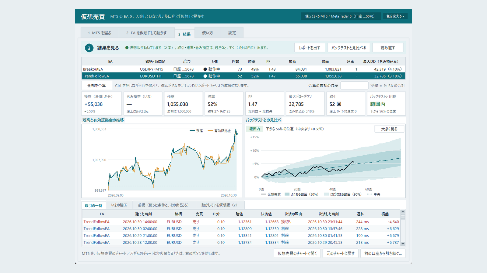
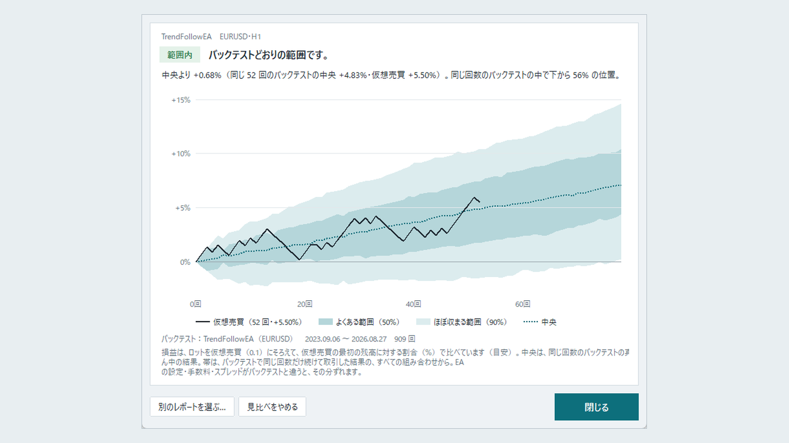
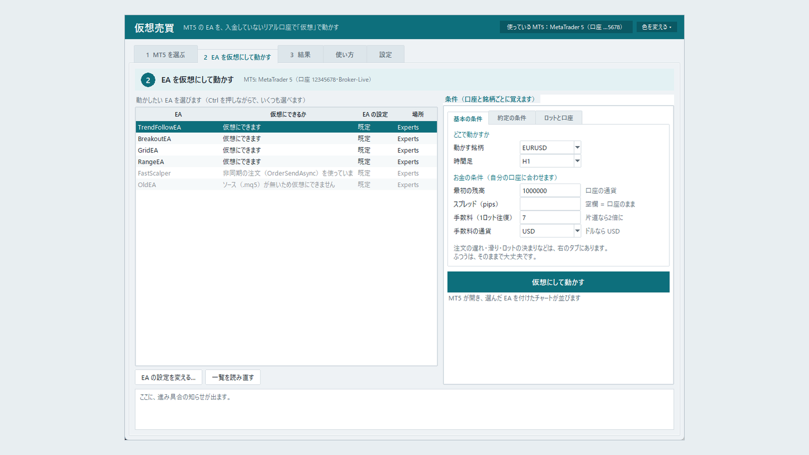
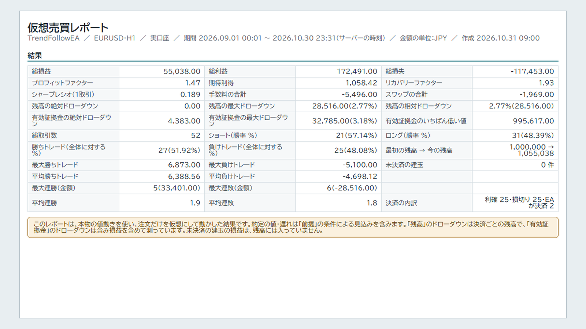
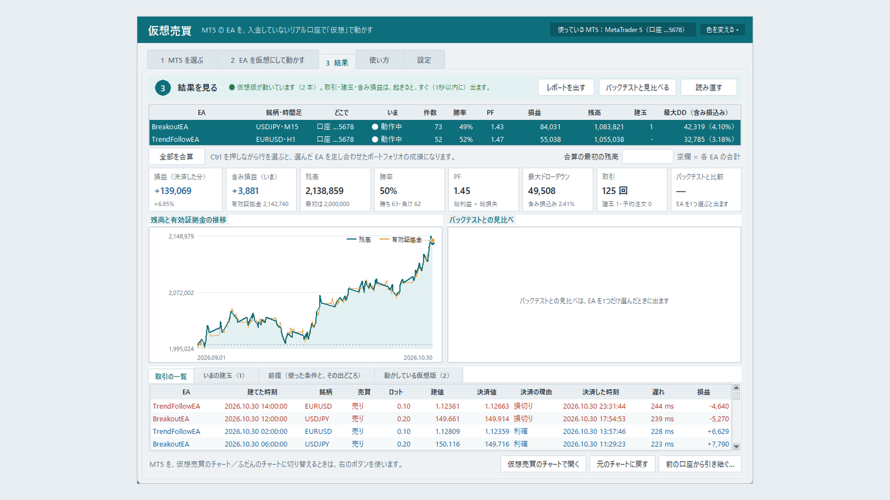
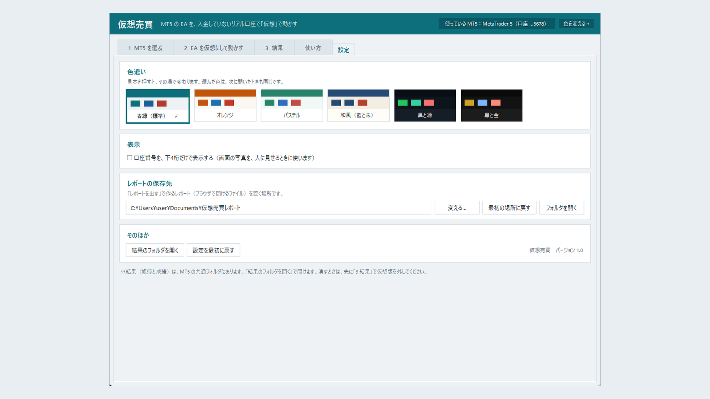

# 仮想売買（MT5 用）

MT5 の EA（自動売買プログラム）を、**入金していないリアル口座**で「仮想」で動かして試すための Windows アプリです。
値動きとスプレッドは口座の本物を使い、注文は1つも出しません。**無料**で配っています。

## できること

- 入金していないリアル口座の、本物の値動きとスプレッドで EA を動かします
- 注文は仮想の帳簿に記録するだけで、本物の注文は出ません
- 使い方は、MT5 を選ぶ → EA のソース（.mq5）を選ぶ → 条件を入れる、の3手順
- 手数料・スプレッド・注文の遅れは自分で入れられます（手数料は円でもドルでも）
- 取引時間、証拠金、ロスカット、スワップも再現します
- 予約注文（指値・逆指値）と、複数の EA の同時稼働に対応
- MT5 を止めていた間の損切り・利確は、次に動かしたときにさかのぼって精算します
- 成績は MT5 のバックテスト風のレポートで出力（残高と有効証拠金の推移つき）
- 複数の EA を合算したポートフォリオの成績も出せます
- MT5 のバックテストのレポートを読み込むと、仮想売買の結果がバックテストどおりの範囲に入っているかを、図で見比べられます
- 取引・建玉・含み損益は、すぐに（1秒以内に）画面に出ます。仮想版が動いているか（動作中・停止中）も、その場で分かります
- 画面の色は、6つの色遣いから選べます
- 少額の残高がある口座でも動かせる設定、口座が変わったときの引き継ぎつき

## 必要なもの

- Windows 10 または 11
- MetaTrader 5（MT5）
- 試したい EA のソース（.mq5）

ソースの無い EA（.ex5 だけのもの）と、MT4 の EA は使えません。

## ダウンロード

**[VirtualTrade_v1.0.zip をダウンロード](../../releases/latest/download/VirtualTrade_v1.0.zip)**（約 13 MB）

zip を展開して、中の「はじめにお読みください.txt」と「取扱説明書.pdf」をお読みください。

- 配っている場所は、このページだけです。ほかの場所にあるものは、作者が配ったものではありません。
- 受け取った zip が本物かどうかは、照合用の値（SHA-256）で確かめられます。値は[リリースのページ](../../releases/latest)に書いてあります。
- このアプリには Windows の「発行元の署名」が付いていません。初めて開くときに警告が出ることがあります。開き方は「はじめにお読みください.txt」に書いてあります。

## 使うときの決まり

このアプリは無料で配っています。使った時点で、次の決まりに同意したものとします。

- **責任**：このアプリを使って起きた損害について、作者は一切の責任を負いません。仮想の成績を見て決めたこと（本物の売買を始める、など）と、その結果も、すべて使う人の責任です。
- **修正・質問**：不具合の修正、質問への回答、機能の追加には対応しません。直したいときは、zip の「ソース」フォルダの中身を AI に見せるなどして、ご自身で直してください。
- **改造**：自分で使うための修正・改造は自由です。
- **使える範囲**：個人が、自分で EA を試すために使う場合に限ります。EA を売っている人も、自分の EA を試すためだけなら使えます。商用の利用（このアプリを売る、有料の商品やサービスに含める、このアプリやレポートを販売や宣伝の材料に使う、など）は禁止します。
- **再配布**：このアプリ（直したものを含みます）と説明書を、ほかの人に渡すこと、ネットに置くことは禁止します。人にすすめるときは、このページを案内してください。
- **成績の見せ方**：仮想の成績やレポートを、本物の取引の成績として見せることは禁止します。

このアプリと説明書の著作権は作者にあります。予告なく内容を変えたり、配るのをやめたりすることがあります。

## 画面の見本

数字はすべて、説明のために作った見本のデータです（本物の口座や EA の成績ではありません）。

バックテストとの見比べ（仮想売買の結果が、バックテストどおりの範囲に入っているか）

EA を選んで、条件を入れる

レポート

いくつもの EA を合算したポートフォリオ

色遣いは、6つから選べます

